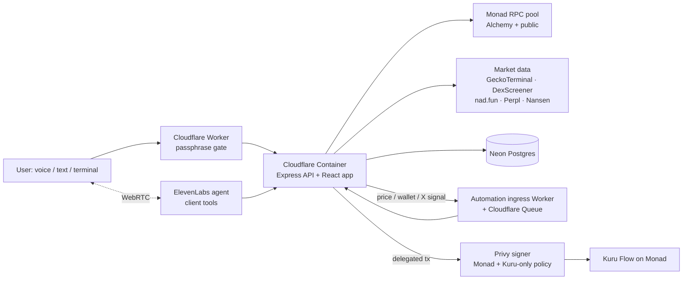

# termeow

**An onchain trading agent for Monad.** Talk to it, and it reads the market from the chain itself, shows you what's trending, explains what it sees, and turns a sentence like *"buy 5% of my wallet in this token if it breaks above $0.05"* into a passkey-approved automation that a policy-locked wallet executes later, through Kuru, while you're away.

Built for **Monad Metropolis** · primary track **Onchain Finance & Trading** · sponsor tracks **Kuru, Privy, Nansen, Perpl, Agora**.

**Live demo:** [termeow.trade](https://termeow.trade). It's a private preview behind a passphrase; the passphrase is in our submission form. The agent opens first; the full trading terminal is one click away at `/onchain`.

---

## Why it matters

Onchain trading today is about watching. You watch charts, wallets and launch feeds, and by the time a setup forms you're too late. termeow flips that around:

1. **Ask** in plain language, by voice or text. The agent pulls live evidence: price structure, order flow, large prints, trending lists, smart-money activity.
2. **Decide**: the agent drafts the exact trade or rule and shows it on an editable card. Nothing moves until you confirm it with your passkey.
3. **Delegate**: an approved rule is armed on the server. When its condition fires, a Privy delegated signer executes the swap through Kuru Flow. The signer can only reach Monad, only call Kuru's contracts, and can never export keys.

## Why Monad

- **Fast blocks.** Sub-second blocks with fast finality mean candles, order flow and wallet tape built from raw swap logs are effectively real time.
- **Cheap reaction.** An automation can react to a price cross or a tracked wallet's fill within a block or two.
- **Cheap execution.** Gas is low enough that a conditional entry plus staged exits still costs little, which makes small, frequent automated positions viable.

## What it does

| | Status |
| --- | --- |
| **Voice and text agent** (ElevenLabs): resolve tokens, analyse a token or wallet, inspect large orders, read Kuru quotes, nad.fun, Perpl and Nansen, propose swaps, MON transfers and automations | Live |
| **Trending tokens** on Monad (tradable), Solana and Robinhood chain (research only), from GeckoTerminal, with a DexScreener fallback | Live |
| **Price-breakout automations**: buy (or dip-buy) when a token crosses a USD level. The server checks every 15 s and fires once through Kuru on the delegated wallet | Live, small-size testing recommended |
| **Wallet-copy automations**: buy when a tracked or labelled wallet buys, within an approved market-cap band | Live |
| **X launch monitor**: buy a contract address the moment a watched X account posts it (via twitterapi.io) | Live |
| **Take-profit / stop-loss exits** | Captured and approved with the entry, **not executed yet** |
| **Trading terminal** (`/onchain`): multi-chart desk with chain-built candles, order-flow windows, CVD, a large-print tape, a nad.fun launch radar and a Perpl regime strip | Live |
| **Smart-money tape and board** from Nansen labels plus your own watchlist | Built; needs a Nansen API key, not enabled on the demo |
| **Voice credits** paid in MON, USDC or Agora AUSD, verified against finalised blocks | Built |

**Interface.** The agent page follows the X Bit Studio layout: a ticker, a pill nav, flat outlined panels and ASCII art. It has a light theme (off-white paper with pastel lavender) and a dark theme (steel grey with pastel mint), both with a paper-grain texture. The persona is an animated ASCII portrait that reacts to the conversation.

## Sponsor-track fit

| Track | Fit | How termeow uses it |
| --- | --- | --- |
| **Kuru** | ★★★★★ | Kuru Flow is the default router for every swap: desk ticket, voice agent and unattended automations. The delegated wallet's Privy policy allowlists only the Kuru Flow entrypoint and router, so Kuru is literally the execution layer. |
| **Privy** | ★★★★½ | Embedded EVM wallets for login and signing, passkey MFA on every agent-proposed action, and server-side delegated execution bound by a Monad-only policy (Kuru contracts only, approvals only to Kuru, key export denied). A full non-custodial agent-wallet story. |
| **Nansen** | ★★★★ | Smart-money netflow, DEX trades, token flow intelligence and wallet labels feed the SMART tape and board, the label book behind wallet-copy automations, and the agent's research tools. |
| **Perpl** | ★★★ | Perps context (mark vs oracle, funding, open interest) in the desk's regime strip and the agent's research tools. Read-only; Perpl orders as an automation action is the obvious next step. |
| **Agora** | ★★½ | AUSD is supported as a funding and credit-payment asset and priced as a stable. Making AUSD the default settlement asset for automations would deepen the fit. |

## Architecture



| Layer | Implementation |
| --- | --- |
| Market tape | Uniswap v2/v3/v4 swap-log pollers and WebSocket over a pool of Monad RPCs, respecting each provider's `eth_getLogs` range cap |
| Launches | nad.fun BondingCurve events (create / buy / sell / graduate) and the nad.fun REST API |
| Trending | GeckoTerminal trending pools per chain (60 s cache); DexScreener-built discovery as a Monad fallback |
| Smart money | Nansen smart-money netflow, DEX trades and labels, plus the user's watchlist |
| Swaps | Kuru Flow aggregator by default, 0x optional |
| Wallets | Privy embedded EVM wallets, passkey MFA, a delegated signer and an `eth_sendTransaction` policy |
| Automations | Server monitors (price every 15 s, tracked-wallet fills, X posts) record a signal; a Cloudflare Queue delivers it to an authenticated fire endpoint that claims the rule once and executes it |
| Voice | ElevenLabs Conversational AI over WebRTC; tools run client-side against the termeow API; spoken input can never confirm a transaction |
| Hosting | Cloudflare Containers behind a Worker with a passphrase gate; Neon Postgres; Alchemy Monad RPC |

## Demo script (≈3 minutes)

1. Open [termeow.trade](https://termeow.trade) and unlock it. The agent boots with its ASCII persona; log in with Privy.
2. Ask **"What's trending on Monad right now?"** The agent calls `get_trending_tokens` and reads back the top tokens with price and momentum. Try **"…and on Solana?"** for research-only lists.
3. Ask **"Pull up the chart for <token>"**. The market HUD opens with chain-built candles; ask about large orders in the last 15 minutes.
4. Say **"Buy 5% of my wallet in <token> if it breaks above <price>."** The agent drafts a `conditional_swap`. The card shows **TRIGGER: PRICE ≥ $X · CHECKED EVERY 15S**; confirm it with your passkey.
5. Open **Automations** to see the armed rule. When the price crosses, the server fires it once through Kuru Flow on the delegated wallet, and the transaction appears on MonadVision.
6. Open the **Terminal** for the full desk: multi-chart workspace, order flow, launch radar and Perpl regime strip.

## Run it locally

Node.js 22.13+.

```bash
cp .env.example .env
npm install
npm run dev
```

Open http://localhost:5174. The API listens on `127.0.0.1:9300` and Vite proxies `/api` to it.

With no keys you still get live Monad market data over public RPCs, Kuru quotes, nad.fun, Perpl and trending lists. Each integration switches on when its key is set (see [`.env.example`](.env.example) and [`docs/API_KEYS.md`](docs/API_KEYS.md)):

| Variable | Enables |
| --- | --- |
| `MONAD_RPC_URL` | A dedicated RPC (e.g. Alchemy) at the head of the pool |
| `PRIVY_APP_ID`, `PRIVY_APP_SECRET`, `VITE_PRIVY_APP_ID` | Login, embedded wallets |
| `PRIVY_AUTOMATION_SIGNER_ID`, `PRIVY_AUTOMATION_AUTH_PRIVATE_KEY`, `PRIVY_AUTOMATION_POLICY_ID` | Unattended execution (`npm run setup:privy-automation` creates the Monad policy) |
| `ELEVENLABS_API_KEY`, `ELEVENLABS_AGENT_ID` | The voice agent (`npm run sync:elevenlabs` pushes the tool set) |
| `DATABASE_URL` | Postgres persistence (`npm run db:migrate`) |
| `NANSEN_API_KEY` | Smart-money data |
| `TWITTERAPI_IO_API_KEY` | The X launch monitor |
| `AUTOMATION_INGRESS_URL`, `AUTOMATION_INGRESS_SECRET`, `AUTOMATION_TRIGGER_SECRET` | The queue that delivers automation signals |

`MONAD_NETWORK=testnet` (with `VITE_MONAD_NETWORK=testnet`) points everything at Monad testnet.

```bash
npm test            # vitest
npm run build       # typecheck + production build
```

## Deploy

- **App:** `workers/termeow-web` runs the app as a Cloudflare Container behind a Worker that serves the passphrase gate and keeps the container warm. Run `npx wrangler deploy -c workers/termeow-web/wrangler.jsonc`, then set the variables above plus `GATE_PASSWORD` and `GATE_SECRET` with `wrangler secret put`.
- **Automation ingress:** `workers/automation-ingress` is the queue in front of the fire endpoint (`wrangler.monad.jsonc` for this deployment).

## Safety model

- Every agent-proposed swap, transfer or automation needs a **passkey-confirmed approval**. Spoken input alone never executes anything.
- Unattended execution uses a **Privy delegated signer** whose policy allows `eth_sendTransaction` only on chain 143, only to Kuru Flow contracts, and ERC-20 approvals only to those spenders. Key and seed export are denied.
- Each automation fires **at most once** per signal (a database claim), expires after its approved window, and respects its approved market-cap band and allocation (max 25% of the wallet per rule).
- The fire endpoint requires a bearer secret held only by the ingress queue and the server.

## Known gaps

- Take-profit / stop-loss exits are stored with the entry but **not executed yet**.
- The live demo has no Nansen key, so smart-money panels are empty there.
- Kuru Flow's router addresses in the Privy policy come from documentation; verify them with a small first trade.
- Some older documents in `docs/` describe the pre-Monad (Solana / Robinhood) system, and a handful of unit tests still assert pre-fork constants.

## Repository map

```
server/    Express API: market tape, launches, trending, smart money, agent tools, automations
src/       React app: agent (/agent) and terminal (/onchain)
shared/    Types and chain profiles shared by both
workers/   Cloudflare Workers: app container + gate, automation ingress
db/        Postgres migrations
scripts/   ElevenLabs tool sync, Privy policy setup, migrations
docs/      Design notes; MONAD_METROPOLIS.md is the original submission write-up
```
